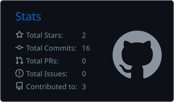
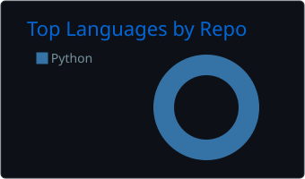

  

  
  

  

  
  

  
  

<table>
  <tr>
    <td width="55%" valign="top">
      <h3>Welcome to my space.</h3>
      
I'm a <b>Computer Science</b> student at Faculdade Estácio, in Mesquita (RJ, Brazil), with a <b>Data Science certification from Oracle Next Education</b> (Alura + Oracle).

      
I enjoy turning everyday problems into code: I've automated the volunteer schedule of a church and built a bot that searches for IT jobs for me every day, running on its own in the cloud.

      
<i>Turning repetitive tasks into code.</i>

    </td>
    <td width="45%" valign="top">
      
🎯 Looking for: <b>IT internship</b>

      
🌱 Studying: <b>Python</b>, <b>SQL</b> and <b>Data Engineering</b>

      
⚙️ Interests: <b>automation</b>, <b>APIs</b> and <b>data processing</b>

      
🎓 Certified: <b>Data Science (ONE)</b>

      
🌎 English: <b>Advanced</b>

    </td>
  </tr>
</table>

<h3 align="center">🛠️ Technologies and tools</h3>

  

  
  
  
  
  
  
  
  
  
  

<h3 align="center">🧭 Areas of interest</h3>

<table>
  <tr>
    <td width="50%" valign="top">
      <h4>📊 Data</h4>
      
Data collection and processing Exporting to Excel spreadsheets Pandas and NumPy

    </td>
    <td width="50%" valign="top">
      <h4>⚙️ Automation</h4>
      
Scripts for repetitive tasks API integration Cloud scheduling with GitHub Actions

    </td>
  </tr>
  <tr>
    <td width="50%" valign="top">
      <h4>🐍 Python</h4>
      
Programming Logic Reading and writing files (JSON, Excel) Automated testing

    </td>
    <td width="50%" valign="top">
      <h4>🗄️ SQL</h4>
      
Basic queries Filtering and grouping Data modeling

    </td>
  </tr>
</table>

<h3 align="center">🚀 Featured projects</h3>

<table>
  <tr>
    <td>
      <h4>🎯 IT and Data Job Radar</h4>
      
      
A Python bot that <b>monitors IT job openings and recruiter posts on LinkedIn</b>, as well as internships on Gupy and Google Jobs, and sends a <b>priority-sorted email</b> twice a day. It runs on its own in the cloud with GitHub Actions, with no server and no cost. It filters by area, seniority and date, never repeats a job, and automatically spreads the monthly API quota across searches.

      
<code>Python</code> · <code>Requests</code> · <code>REST APIs</code> · <code>GitHub Actions</code> · <code>unittest</code>

    </td>
  </tr>
  <tr>
    <td>
      <h4>⛪ Church Task Scheduler</h4>
      
      
A Python script that <b>automates the monthly volunteer schedule</b> of a local church, a process that used to be done by hand every month. It fairly distributes the tasks for every Sunday, respects each volunteer's restrictions and <b>exports everything to an organized Excel spreadsheet</b>, with one tab per schedule.

      
<code>Python</code> · <code>openpyxl</code> · <code>JSON</code> · <code>Excel</code>

    </td>
  </tr>
</table>

<h3 align="center">🎓 Education and certifications</h3>

**Computer Science** · Faculdade Estácio · 2025 – 2029 (expected)

**Data Science – Oracle Next Education (ONE / Alura + Oracle)**, with courses in ETL, Python and Data Fundamentals, Pandas, NumPy, Data Modeling, Statistics with Python, Machine Learning with scikit-learn, Linear Regression and AI applied to Data Science.

<h3 align="center">📈 Stats</h3>

  
  

  

<i>“Learning a little every day and building through practice.”</i>

